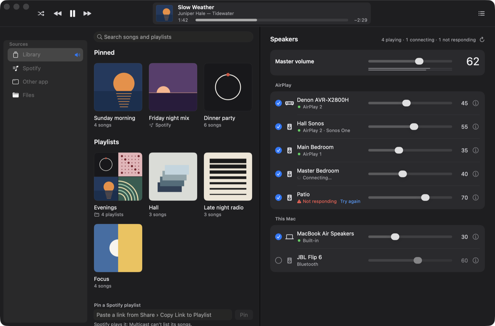
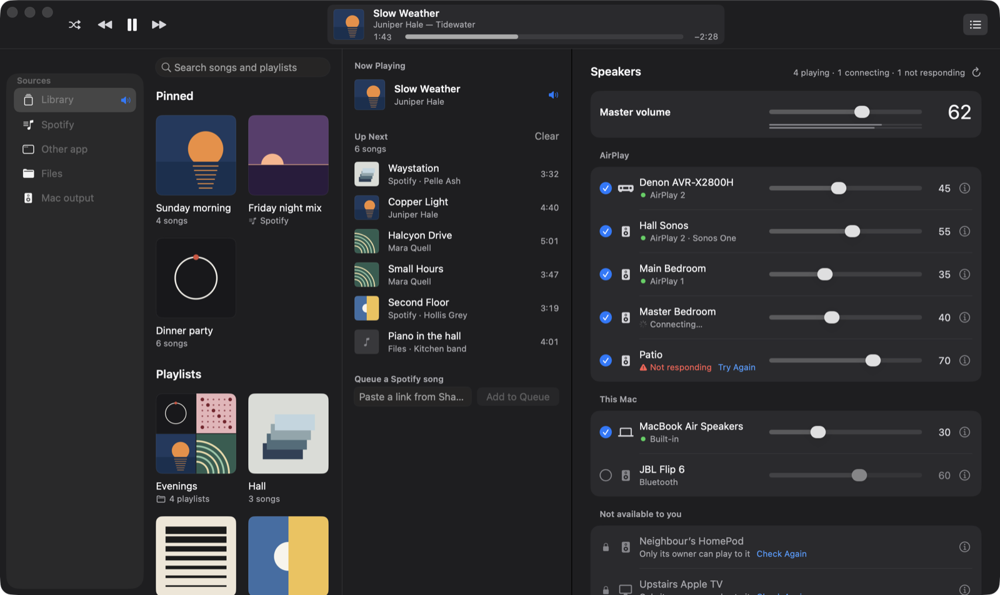
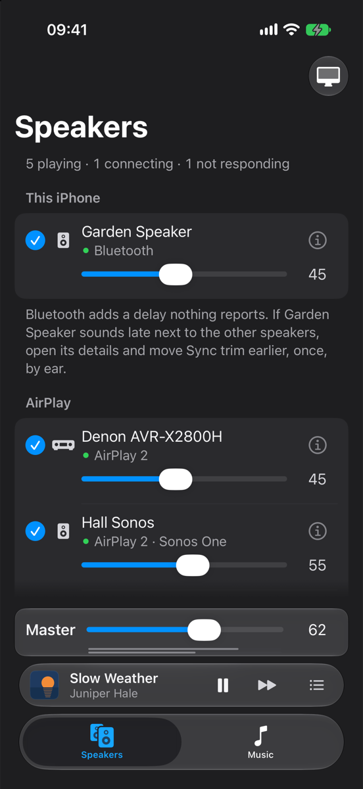
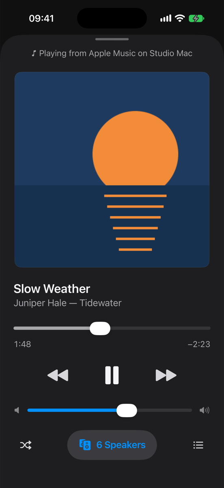
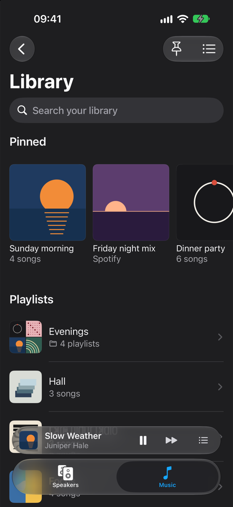
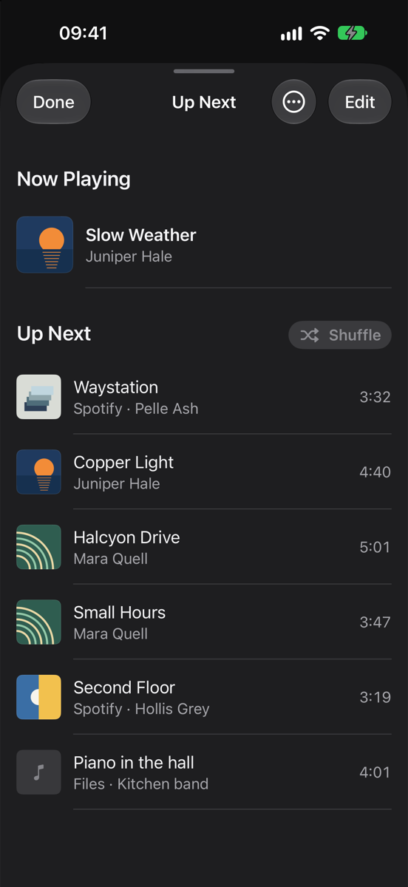

# Multicast

Play one audio stream in sync on every speaker in the house, from a Mac, with an iPhone as the remote.

Multicast is a Mac app that acts as a hub. It plays Apple Music, the sound of any other app on the Mac, or
DRM-free files, and sends that one stream to as many speakers as you pick at the same time: AirPlay 1 receivers
(including AirConnect bridges to Sonos and UPnP players), AirPlay 2 devices, and the Mac's own and Bluetooth
outputs. It is what iTunes for Windows used to do with several AirPlay speakers, and the iPhone app,
Multicast Remote, plays the part of the old iTunes Remote.

<p align="center">
  
</p>

## What it does

- **Many speakers, one timeline.** Turn speakers on and off while playing, set each one's volume and a master
  volume, and nudge any speaker earlier or later with a per-speaker sync trim.
- **Apple Music library.** Playlists and playlist folders, pinned playlists, search, and an Up Next queue owned by
  the hub, with Play Next, Add to Queue and Shuffle.
- **Other sources.** Capture the sound of any other app on the Mac, or play DRM-free audio files.
- **iPhone remote.** Pairs with the Mac once using a 6-digit code over an encrypted link, then controls speakers,
  volumes, sync trim, playback, Up Next and the library.
- **Menu bar.** The Mac app keeps running in the menu bar with now playing and the speaker list.
- Apple frameworks only; no third-party code.

## Screenshots

These are the apps' own review renders with sample data (`--snapshot` on the Mac, `-MCScene` on the iPhone).

Up Next slides in beside the library. It is the hub's queue, so the Mac and every paired iPhone see the same list.

<p align="center">
  
</p>

The iPhone remote: speakers, now playing, the library and Up Next.

<p align="center">
  
  
  
  
</p>

## How it works

- **Hub.** The Mac app runs `LocalHub`, which owns the state: the chosen source, the speakers, their volumes and
  trims, and the play queue. The Mac window, the menu bar and every iPhone are views onto it.
- **Engine.** The chosen source is decoded or captured as PCM, paced by one clock, and fanned out to every speaker:
  RAOP (AirPlay) senders for network speakers and Core Audio for this Mac's own and Bluetooth outputs.
- **Shared timeline.** Every speaker is told to play each packet at the same moment on one timeline, a fixed group
  latency (2 s by default) ahead of now. A per-speaker trim moves one speaker earlier or later to make up for
  delays nothing on the network reports, such as a bridge's downstream player or Bluetooth.
- **Remote link.** The hub advertises itself over Bonjour. An iPhone pairs once with a 6-digit code shown on the
  Mac; after that each connection is an encrypted ChaCha20-Poly1305 session, and the iPhone sends the same
  commands the Mac window does.

## Build and run

Requires macOS 14.4 or later for the Mac app (the Swift packages build for macOS 14) and iOS 17 or later for the
iPhone app, with Xcode.

```bash
swift build
swift test

# The Mac hub app: build it, install it in /Applications and open it from there.
# (macOS ties Local Network access to where the app lives, so always run the installed copy.)
Apps/Scripts/run-mac.sh

# The iPhone remote (simulator)
xcodebuild -project Apps/Multicast.xcodeproj -scheme "Multicast Remote" \
    -destination 'generic/platform=iOS Simulator' -derivedDataPath .build-xcode-ios build
xcrun simctl install booted ".build-xcode-ios/Build/Products/Debug-iphonesimulator/Multicast Remote.app"
xcrun simctl launch booted io.github.longtimeno-c.multicast.remote
```

The Mac app is signed to run locally (ad hoc) unless you sign it with your own team; see
[Permissions](#permissions-the-mac-asks-for) and `Apps/Config/Mac.xcconfig`. More launch options are under
[Apps](#apps).

## Architecture

```
iPhone: Multicast Remote ── HubModel ── RemoteHubBackend ─┐  Bonjour _multicast-hub._tcp,
Mac:    Multicast (window, menu bar) ── HubModel ─────────┤  6-digit pairing, ChaCha20-Poly1305 session
                                                          ▼
        HubServer ──► LocalHub (HubBackend) ──► MulticastSession ──► MulticastEngine (pacer + fan-out)
                        │  sources: Files, Spotify / any app (process taps), Apple Music (Music app)
                        └─ speakers: SpeakerDirectory ──► RAOP sinks (AirPlay 1/2) + Core Audio sinks
```

- `MulticastHubModel` is the seam: UI value types, `HubState`, the Codable `HubCommand`/`HubQuery` vocabulary and the
  `HubBackend` protocol. Every UI (Mac window, menu bar, iPhone) talks only to a `HubBackend`.
- `LocalHub` (`MulticastHub`) is the real backend on the Mac; `RemoteHubBackend` (`MulticastRemote`) is the same
  protocol over the network; `MockHubBackend` (`Apps/Shared/Mock`) drives previews and snapshots.
- `HubServer` serves one `HubBackend` to any number of paired remotes.

## Modules

- `Sources/MulticastAudio` — contracts shared by every module (PCM format, timeline, source/sink protocols)
- `Sources/MulticastDiscovery` — Bonjour discovery of AirPlay speakers
- `Sources/MulticastRAOP` — AirPlay (RAOP) sender; AirPlay 2 devices are driven over RAOP after `POST /auth-setup`
- `Sources/MulticastLocalOutput` — local and Bluetooth outputs
- `Sources/MulticastSources` — tone, file, app-audio capture and Mac-output (`OutputDeviceSource`) sources, and
  `PushedAudioSource` for audio pushed in by a capturer (the iPhone's broadcast extension)
- `Drivers/MulticastDevice` — the "Multicast" output device (an AudioServerPlugIn) that the Mac output source reads; see its DESIGN.md for build, install and uninstall
- `Sources/MulticastEngine` — pacing clock and fan-out
- `Sources/MulticastKit` — `SpeakerDirectory`, `SinkFactory` and `MulticastSession` (the façade over all of the above)
- `Sources/MulticastHubModel` — the UI seam described above (no dependencies; macOS and iOS)
- `Sources/MulticastHub` — `LocalHub`, the hub backend; `AppleMusicHubPlayer` connects the Apple Music player to it
- `Sources/MulticastAppleMusic` — Apple Music for the hub: `MusicAppPlayer` (the Music app over Apple Events, the
  default), `MusicKitPlayer` (MusicKit) and `CatalogRoutingProvider` (the Music app for the library, MusicKit for
  catalog songs; see Limitations)
- `Sources/MulticastRemote` — `HubServer`, `RemoteHubBackend`, `HubBrowser`, pairing and the encrypted session
- `Sources/multicast-cli` — play to speakers from the command line
- `Sources/multicast-hub` — the hub without its window (same `LocalHub` and `HubServer` as the app)
- `Sources/multicast-remote-cli` — a scripted remote: pairs and drives a hub like the iPhone app does
- `Sources/raop-probe` — low-level RAOP test tool

## Apps

`Apps/Multicast.xcodeproj` has three targets (build commands are under [Build and run](#build-and-run)): the Mac
app, the iPhone app and the iPhone app's broadcast extension, which is built and embedded with it.
Per-target settings (bundle id, Info.plist, entitlements, signing, deployment target) live in
`Apps/Config/Mac.xcconfig`, `Apps/Config/iOS.xcconfig` and `Apps/Config/iOSBroadcast.xcconfig`. To sign the Mac app with your own team, create the
git-ignored `Apps/Config/Local.xcconfig` as described in `Mac.xcconfig`.

**Mac app (`Multicast`).** Runs the real hub: it finds the speakers, plays the chosen source, serves iPhone
remotes and lives on in the menu bar. Launch options:

- `--mock` — run on the mock hub (no audio, no network).
- `--snapshot <dir>` — render review PNGs of key states (mock data) and exit.
- `--pairing-code-log <file>` — also write each pairing code to `<file>` (mode 0600) so a script can pair.
- Audio files opened with Multicast (Finder's Open With, or `open -a Multicast.app song.flac`) are added to Files.
- Quit (or `kill <pid>`) disconnects every speaker and removes capture taps before the app exits.

Settings: menu-bar extra, buffer (1–3 s), which Apple Music player to use, and **Remotes**: the paired iPhones, each
with Remove (after a confirmation it is disconnected at once and must pair again).

**iPhone app (`Multicast Remote`).** Lists the Macs on the network; choose one to pair. With no launch arguments it
is the real remote. `-MCScene <name>` (`mock`, `pair`, `pairing`, `speakers`, `now-playing`, `playlists`, … see
`Apps/iOS/Support/RemoteScenes.swift`) and `-MCAppearance light|dark` launch fixed review scenes on the mock hub.

### iPhone Only (experimental)

With no Mac, the iPhone app can play what the iPhone itself is playing on AirPlay speakers. Open it from
**Use iPhone Only** on the Connect screen, or from the hub menu on the Speakers tab.

iOS lets an app hear other apps only through a screen broadcast, so that is how it works: turn on speakers, tap
**Start Broadcast** and choose Multicast. The `Multicast Broadcast` extension (`Apps/iOSBroadcast`, a ReplayKit
broadcast upload extension) then receives the playing app's audio, converts it to the pipeline format
(`PushedAudioSource`) and sends it to the chosen speakers with the same engine and timeline as the Mac
(`PhoneBroadcastRunner`). The app and the extension share the chosen speakers, volumes, sync trims and the
broadcast's status through an App Group; volumes and speakers can be changed while it plays.

What to expect:

- Sound reaches the speakers about 2 seconds after the iPhone plays it, so video is out of sync.
- The red broadcast indicator stays on, and the iPhone keeps playing through its own speaker, ahead of the others.
- Some apps silence or hide themselves while the screen is broadcast. The screen says "Playing, but hearing
  silence" when buffers arrive with nothing in them.
- AirPlay speakers only; a speaker that needs a password is not supported in this mode.

It cannot run in the simulator. A device build needs your team in the git-ignored `Apps/Config/Local.xcconfig`
(`DEVELOPMENT_TEAM = <your team id>`) and `-allowProvisioningUpdates`, so Xcode can register the two bundle ids
and the App Group `group.io.github.longtimeno-c.multicast`:

```bash
xcodebuild -project Apps/Multicast.xcodeproj -scheme "Multicast Remote" \
    -destination 'generic/platform=iOS' -derivedDataPath .build-xcode-device -allowProvisioningUpdates build
```

Review scenes on made-up speakers: `-MCScene phone-only`, `phone-only-playing`, `phone-only-silent`,
`phone-only-unreachable`, `phone-only-stopped`, `phone-only-searching`, `phone-only-empty`.

### Play queue, pinned playlists and the library

The hub owns one play queue, the same on the Mac and every iPhone. It can hold Apple Music, Spotify and file songs
together, and plays each one with its own app, switching the captured source as it goes. The speakers stay selected
across a switch, and only a skip flushes their audio.

- **The library is playlists**: pinned ones first, then every playlist (artwork tiles on the Mac, a list on the
  iPhone). Opening one shows its artwork, Play and Shuffle, and its songs. Search finds songs and playlists, and
  its results show only while you search.
- **Apple Music catalog.** When the hub can search the Apple Music catalog, search shows an "Apple Music" section
  under the library's results: the top 25 catalog songs, which needn't be in your library. They play, Play Next
  and Add to Queue like any other song, through the same Up Next. The Music app can only be told to play library
  tracks, so with the Music app as the player a catalog song plays through MusicKit instead (Music is paused for
  it, and resumed by the next library song), and one capture hears both. The section needs a build registered for
  MusicKit (see [Permissions](#permissions-the-mac-asks-for)) and is simply absent otherwise.
- **The player** is the Mac window's title bar, as in Music: transport and Shuffle, then what is playing with its
  scrubber, then an Up Next button (Option-Command-U) that slides Up Next in beside the library. On the iPhone, the
  full player has Shuffle and Up Next either side of the speakers button, and the mini player and the library
  open Up Next in one tap. Shuffle shuffles what is left in Up Next; turning it off puts the songs back in order.
- **Playing a song from a list** (a playlist, search results, Files, or Spotify songs from this session)
  plays it and makes Up Next everything after it in that list, in order. **Play** and **Shuffle** on an open
  playlist play the whole list in order or shuffled.
- **Play Next** and **Add to Queue** are on every song: the context menu on the Mac, a swipe right or a long press
  on the iPhone. Up Next shows the hub's queue: click or tap plays a song (the ones before it are dropped). On the
  Mac you drag to reorder; on the iPhone you use Edit. You can remove songs one at a time or clear the whole list.
- **Spotify songs** enter the queue without a Spotify Client ID in two ways. One is a song Spotify played this
  session; Spotify gives its `spotify:track:` URI. The other is a pasted share link (`open.spotify.com/track/…`).
  For a link, the hub asks Spotify's public oEmbed endpoint for the title and cover. That is a network call to
  Spotify, made only when a link is pasted; if it fails, the song is queued as "Spotify song".
- **How a song ends**: the Music app is asked to play one track (`play … once`), and Spotify plays
  `play track "spotify:track:…"`. The hub works out from the app's last report when the song will end, and starts
  the next one about 0.15 s before that. Otherwise Music carries on into its own next track (it does, even with
  `once`), and Spotify into its autoplay. The next song also starts if the app reports the song stopped, paused at
  its end, or moved on before the timer fires.
- **When you play something directly in Music or Spotify**, the app takes over: the hub follows it, as before, and
  the queue waits (Up Next says so). Next, or choosing a song in Up Next, carries on with the queue. Choosing
  another source or app in Multicast does the same.
- **At the end of the queue** playback stops, and Spotify is paused so its autoplay stays quiet. Adding songs
  while nothing plays doesn't start them; Play does.
- **Pinned playlists** sit at the top of the library: a click opens one (a Spotify playlist plays instead). You pin an
  Apple Music playlist from its context menu or with the pin button of an open playlist. You pin a Spotify
  playlist by pasting its share link; Spotify plays it (shuffle optional), and its songs aren't listed. Pins are
  kept in the hub's settings.
- **One library**: with Apple Music allowed and Spotify installed, Apple Music becomes **Library**, and it lists
  both apps' playlists and finds both apps' songs, with Spotify items marked. Without a Client ID, Spotify can only
  give the songs it played this session (found by search) and pinned playlists. The Spotify source keeps its
  capture controls.

### Pairing

1. Open Multicast on the Mac and Multicast Remote on the iPhone, on the same network.
2. On the iPhone, choose the Mac. The Mac shows a 6-digit code in a small window.
3. Type the code on the iPhone. Done: from now on the iPhone reconnects by itself.

A wrong code asks the Mac for a new one; three failures in a row lock pairing for a minute (doubling, up to an
hour). Pairing keys live in the Keychain on both sides. An iPhone drops its key only when you choose Forget, or
when the Mac removes it inside the encrypted session; a Mac that merely fails to recognise the pairing (or anything
on the network answering with its id) shows as unreachable and the iPhone keeps retrying. The protocol and its
threat model are described in `Sources/MulticastRemote/Crypto.swift`.

### Permissions the Mac asks for

| Permission | Needed for | Without it |
|---|---|---|
| Local Network | finding AirPlay speakers, and letting iPhones find the Mac | only this Mac's own outputs; remotes can't connect (shown in the speakers list, the menu bar panel and Settings, with a button to the right pane; once it is turned on the Mac picks it up within about 10 s) |
| System Audio Recording | Spotify, other apps and Apple Music (all captured) | those sources play silence; shown on the source |
| Automation (Spotify, Music) | now playing and play/pause/skip; the Music app player | Spotify plays but can't be controlled; Apple Music unavailable |
| Media & Apple Music | the MusicKit player; Apple Music catalog search | no catalog results in search |

Multicast never asks unprompted: each prompt follows a button press ("Allow…"), and a refusal points to the
right pane of Privacy & Security.

The Mac app is signed "to run locally" (ad hoc). macOS treats every rebuild as a new app, so it may ask again
for these permissions and for Keychain access to the pairing keys. Signing with your own team avoids that (see
`Apps/Config/Mac.xcconfig`).

Catalog search also needs a developer token, which MusicKit fetches by itself from Apple for the app's bundle id.
Apple only issues one when an explicit App ID with that bundle id has the **MusicKit** app service turned on
(Certificates, Identifiers & Profiles › Identifiers › the App ID › the *App Services* tab, not *Capabilities*).
Nothing in the project or its signature takes part: no entitlement, no provisioning profile. If the App ID isn't
registered that way, Apple's token service answers "Client not found", MusicKit reports
`developerTokenRequestFailed`, and search shows no Apple Music section. To build under your own account, change
`PRODUCT_BUNDLE_IDENTIFIER` to one you have registered. `Multicast.app --catalog-experiment "<term>" --no-play
--experiment-log <file>` tries one search and logs the outcome.

Local Network access also follows the main executable's Mach-O UUID (Apple's TN3179). A Debug build's main
executable is a small stub (the app's code is in `Multicast.debug.dylib`), so its UUID survives rebuilds, but Xcode
links into it an absolute rpath to the checkout's own build folder, which gave every checkout and worktree a
different UUID and so a separate Local Network grant. The Mac target's "Stable Debug UUID" build phase
(`Apps/Scripts/stable-debug-uuid.py`) removes that rpath and gives the Debug stub a UUID made from the bundle id
and the Xcode build, architectures, deployment target and configuration: the same in every checkout, new only
when Xcode or those settings change (then allow Local Network once more). Release builds are left as linked.

If iPhones can't find the Mac because Local Network is off, the Mac retries its server for remotes after 10 s,
then 20, 40 … up to every 5 minutes, and at once when you switch back to Multicast (from System Settings, say).

### Finding and keeping speakers

- The speaker list is browsed again every 45 s, whenever the Mac's network interfaces change, and on
  **Refresh speakers** (the ↻ button in the speakers panel and the menu bar panel; pull down, or the Mac menu, on
  the iPhone). Speakers already known stay listed while the fresh answers come in.
- A speaker that stops answering stays in the list; after 20 s its row says "Not seen on the network", and after
  3 minutes it is removed (a speaker that is on stays listed regardless).
- While playing, a network speaker that fails is retried by itself after 2, 5, 10, 20 and then every 30 s, and at
  once when it reappears on the network or on Refresh. A wrong password, or picking the same receiver twice, is
  not retried. "Try again" retries at once.

## Command line

```bash
# Every speaker this Mac can play to (this Mac's own AirPlay receiver is hidden; --show-self shows it)
swift run multicast-cli list

# A quiet 440 Hz tone on three speakers at once, for 8 s
swift run multicast-cli play --tone --to "MacBook Air Speakers" --to "Main Bedroom" --to "Hall Sonos" --volume 0.12 --seconds 8

# A file on two speakers, the bridge trimmed 40 ms later
swift run multicast-cli play --file song.m4a --to "Main Bedroom" --to "Hall Sonos" --offset "Main Bedroom=40"

# Capture one app (or, without --app, everything except this process) — macOS 14.2+
swift run multicast-cli play --capture --app com.spotify.client --to "Hall Sonos"

# Add and remove speakers while playing (seconds after audio starts)
swift run multicast-cli play --tone --to "Main Bedroom" --add-at "2:Hall Sonos" --remove-at "5:Main Bedroom"
```

- `--to` takes a speaker name, a unique name prefix or an id (`multicast-cli list` shows ids).
- `--volume` is per speaker, 0…1 (default 0.12), and reaches each speaker before any audio.
- `--seconds` is audible time (default 8), fade included: the run reports the measured audible time at the end.
  The audio fades out at the end; Ctrl-C fades out and tears every connection down (a second Ctrl-C skips the
  fade). Exit codes: 0 ok, 1 a speaker failed, 2 usage, 130 interrupted.
- `--latency-ms` sets the group latency (default 2000). `--verbose` prints the RTSP exchange.
- Two advertisements of one physical device (an AirConnect bridge and the native AirPlay 2 receiver) are refused together.
- A status line every second shows each speaker's state, RTP packets sent, retransmit requests and timing replies
  (network) or sync error and rate correction (local).

### Headless hub and scripted remote

```bash
# The hub without a window, serving remotes; a file added to Files; stops after 10 minutes
swift run multicast-hub --name "Test Hub" --add song.m4a --store /tmp/hub-keys.json \
    --pairing-code-log /tmp/code.txt --seconds 600

# A remote that pairs (reading the code file), turns three speakers on at 0.1, plays the file,
# changes a volume, turns one speaker off mid-stream and stops, printing every state change it sees
swift run multicast-remote-cli run --hub "Test Hub" --store /tmp/remote-keys.json --code-file /tmp/code.txt \
    pair "volume=Main Bedroom:0.1" "on=Main Bedroom" "volume=Hall Sonos:0.1" "on=Hall Sonos" \
    "play-file=song" "expect=Hall Sonos:playing" sleep=3 "volume=Hall Sonos:0.08" "off=Main Bedroom" sleep=2 pause
```

`multicast-remote-cli hubs` lists the hubs on the network; the full list of steps is in the header of
`Sources/multicast-remote-cli/main.swift`. `--store` keeps pairing keys in a 0600 file instead of the Keychain.

## Status and limitations

Multicast is a work in progress. There are development builds only: no signed, notarized release to download.

- **Spotify:** opening, play, pause and skip work, but capturing Spotify's sound does not work at the moment, so
  Spotify can't be played to the speakers yet. Spotify songs and playlists in the queue and library depend on it.
- **iPhone Only mode has never run on an iPhone.** Its audio conversion, buffering and the code that plays a
  broadcast to speakers are unit-tested on the Mac, both iOS targets build and sign for a device, and the screens
  are checked in the simulator. The capture itself (what ReplayKit delivers, memory inside the extension, Local
  Network access from the extension, sync by ear) is untested. Whether Apple Music and Spotify give a broadcast
  real audio or silence is unknown: people report that iOS screen recordings of Apple Music have no sound, and
  one report says Spotify's do, but nothing here has confirmed either.
- **Sync is verified by protocol and state, not by ear.** Speakers report playing, RTP counters and timing
  replies are healthy, but nobody has listened to confirm the rooms line up.
- **AirPlay 1 bridges (AirConnect and similar) need a sync trim, set by hand,** and sync across bridges has not
  been checked by ear. The bridge itself plays to our timing: it reports its buffer in `Audio-Latency` from
  RECORD (22050 frames, 0.5 s, for AirConnect 1.12.4), and that is the receiver's minimum buffer, already covered
  by the 2 s group latency. The extra delay comes from the device behind the bridge (a Sonos or UPnP renderer
  buffering the bridge's HTTP stream), which nothing on the network reports, and it has not been measured here.
  So Multicast applies no default offset to bridges; set speaker details → Sync trim per bridge. The trim range
  is −500…500 ms; positive plays later.
- **Apple Music** plays through the Music app (Apple Events plus a capture of Music's audio), so it needs
  Automation and System Audio Recording. Music doesn't expose its own Up Next to Apple Events, so the hub keeps its
  own queue and plays Music one track at a time. MusicKit's `ApplicationMusicPlayer` is rendered by the system
  process `com.apple.MediaPlayer.RemotePlayerService`, which a process tap captures (measured with library songs).
- **Apple Music catalog search** has been run live with the Music app as the player: a song that is not in the
  library was found, played through the hub's queue to the Mac's own speakers, and captured (non-silent capture
  cycles on the tap that covers Music and `RemotePlayerService`); seeking to 4 s before its end started the next
  catalog result about 5 s later, after roughly a second of silence. Not yet run: going between a playing Music
  app and a catalog song, AirPlay speakers, and the iPhone remote against a real hub. The MusicKit renderer keeps
  its output open for a few seconds after Multicast stops it. Until the permission for Media & Apple Music has
  been granted (choose MusicKit under Settings once), the section stays absent; there is no button for it in
  search.
- **The play queue** has been run live from Apple Music to Apple Music: the next song started about 8 s after a seek
  to 8 s before the end, with no foreign track in between. Apple Music to Spotify is verified only as far as the
  switch: the queued Spotify song didn't start while the first AppleScript compile in the Multicast process was
  held for tens of seconds by the system's security scan (not by Spotify). Track-end detection for Spotify is
  covered by unit tests only.
- **Ad hoc signing** means macOS treats every rebuild as a new app and may ask for permissions and Keychain access
  again (see [Permissions](#permissions-the-mac-asks-for)).
- The remote link has not been reviewed by a third party; its threat model and gaps are in `Crypto.swift`.
